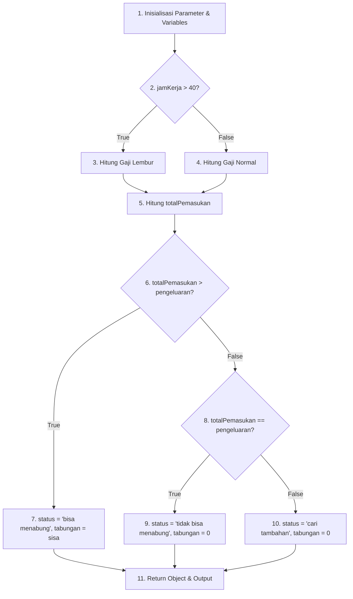
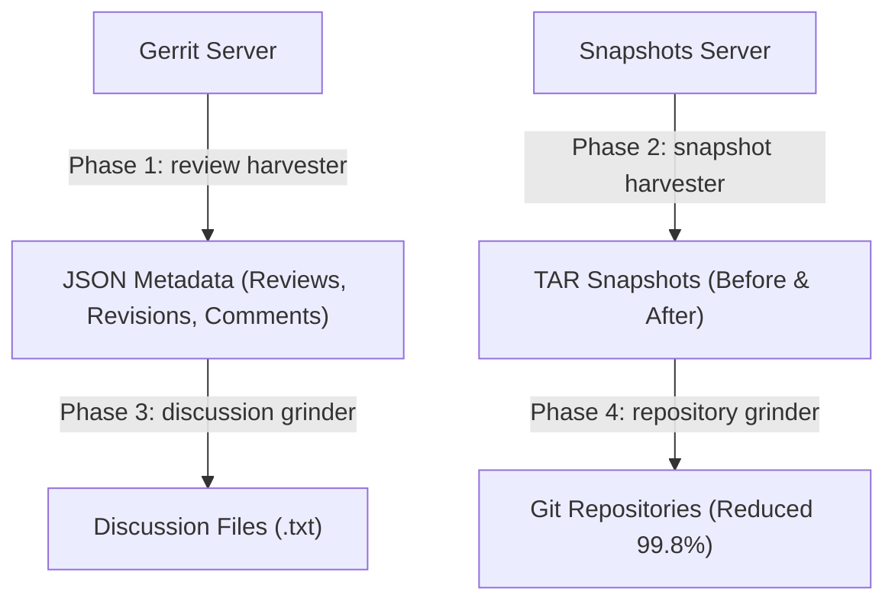

# Laporan UTS Software Testing: Code Review (CR)

## SOAL 1: Penjelasan 5W Code Review (CR) [Bobot 10%]

### 1.1 What (Apa itu Code Review?)

Code Review (CR) adalah pengujian perangkat lunak terencana di mana perubahan kode sumber (*source code*) diperiksa secara manual atau semi-otomatis oleh pengembang lain (*peer reviewer*) sebelum digabungkan (*merge*) ke dalam repositori utama. Tujuannya adalah menemukan kesalahan logika, *bug*, celah keamanan, serta memastikan keterbacaan kode (*clean code*).

### 1.2 Who (Siapa yang Terlibat?)

* **Author / Developer:** Pengembang yang menulis fitur baru atau melakukan perbaikan *bug*.


* **Peer Reviewer:** Rekan sesama *developer* atau *senior engineer* yang memeriksa kode, memberikan catatan/kritik konstruktif, serta memberikan persetujuan (*approval*).


* **Maintainer / Lead Developer:** Pihak yang bertanggung jawab menyetujui penggabungan (*final merge*) ke *branch* utama.


### 1.3 Where (Di Mana Code Review Dilakukan?)

* **Version Control System (VCS) Platform:** Melalui fitur *Pull Request* (PR) di GitHub atau *Merge Request* (MR) di GitLab/Bitbucket.
* **Dedicated Code Review Tools:** Menggunakan sistem *Modern Code Review* khusus seperti Gerrit, Phabricator, atau Crucible.


* **Sesi Offline / Pair Walkthrough:** Peninjauan kode secara langsung di hadapan tim (*inspection/walkthrough*).

### 1.4 Why (Mengapa Code Review Penting?)

* **Deteksi Cacat Dini (*Defect Detection*):** Menemukan kesalahan logika, *bug*, dan *code smell* sebelum kode masuk ke lingkungan produksi.


* **Penyebaran Pengetahuan (*Knowledge Sharing*):** Membantu seluruh anggota tim memahami bagian arsitektur kode yang dikerjakan oleh anggota lain.


* **Konsistensi Standar (*Code Consistency*):** Memastikan penulisan kode mematuhi panduan gaya (*coding style guide*) tim.


* **Keamanan dan Performa (*Security & Performance*):** Mencegah potensi *vulnerability* dan kemacetan performa (*bottleneck*).


### 1.5 When (Kapan Code Review Dilakukan?)

* **Pre-Merge:** Setelah *developer* selesai membuat kode dan lolos pengujian unit lokal, tetapi sebelum kode digabungkan ke basis kode utama.


* **Iteratif saat Siklus Pengembangan:** Dilakukan setiap kali *author* memperbarui komitmen (*commit*) berdasarkan catatan atau masukan dari *reviewer*.


---

## SOAL 2: Proses Manual Code Review — Studi Kasus John Travolta [Bobot 35%]

### 2.1 Algoritma Program

1. **Inisialisasi & Input:** Terima parameter `jamKerja`, `pengeluaran`, dan `tarifNormal` (default Rp 15.000). Tentukan konstanta `JAM_NORMAL_MAX = 40` dan `TARIF_LEMBUR = tarifNormal * 1.5` (Rp 22.500).


2. **Kalkulasi Gaji (Percabangan 1):**
* Jika `jamKerja > 40`: Hitung `jamLembur = jamKerja - 40`, `gajiNormal = 40 * tarifNormal`, dan `gajiLembur = jamLembur * TARIF_LEMBUR`.


* Jika `jamKerja <= 40`: Set `jamLembur = 0`, `gajiNormal = jamKerja * tarifNormal`, dan `gajiLembur = 0`.


3. **Kalkulasi Total Pemasukan:** Hitung `totalPemasukan = gajiNormal + gajiLembur`.


4. **Evaluasi Status Keuangan (Percabangan 2):**
* Jika `totalPemasukan > pengeluaran`: Set `status = "bisa menabung"`, `tabungan = totalPemasukan - pengeluaran`.


* Jika `totalPemasukan === pengeluaran`: Set `status = "tidak bisa menabung"`, `tabungan = 0`.


* Jika `totalPemasukan < pengeluaran`: Set `status = "cari tambahan"`, `tabungan = 0`.


5. **Output:** Kembalikan (*return*) objek rincian keuangan.


### 2.2 Kode Sumber (Javascript) & Pemetaan Simpul (Nodes)

```javascript
(1)  function hitungKeuangan(jamKerja, pengeluaran, tarifNormal = 15000) {
         const JAM_NORMAL_MAX = 40;
         const TARIF_LEMBUR = tarifNormal * 1.5;
         let jamLembur = 0, gajiNormal = 0, gajiLembur = 0;

(2)  if (jamKerja > JAM_NORMAL_MAX) {
(3)      jamLembur = jamKerja - JAM_NORMAL_MAX;
         gajiNormal = JAM_NORMAL_MAX * tarifNormal;
         gajiLembur = jamLembur * TARIF_LEMBUR;
     } else {
(4)      gajiNormal = jamKerja * tarifNormal;
         gajiLembur = 0;
     }

(5)  const totalPemasukan = gajiNormal + gajiLembur;
     let status = "", tabungan = 0;

(6)  if (totalPemasukan > pengeluaran) {
(7)      status = "bisa menabung";
         tabungan = totalPemasukan - pengeluaran;
(8)  } else if (totalPemasukan === pengeluaran) {
(9)      status = "tidak bisa menabung";
         tabungan = 0;
     } else {
(10)     status = "cari tambahan";
         tabungan = 0;
     }

(11) return { jamKerja, jamLembur, gajiNormal, gajiLembur, totalPemasukan, pengeluaran, status, tabungan };
}

```

### 2.3 Control Flow Graph (CFG)



### 2.4 Cyclomatic Complexity & Jalur Independen (Basis Paths)

#### Perhitungan Cyclomatic Complexity $V(G)$:

* **Metode 1: Predicate Nodes ($P$)**
Terdapat 3 simpul keputusan predikat (`if` / `else if`): **Node 2**, **Node 6**, dan **Node 8**[cite: 1, 156].

$$V(G) = P + 1 = 3 + 1 = 4$$


* **Metode 2: Edge ($E$) dan Node ($N$)**
Jumlah Edge ($E$) = 13 alur, Jumlah Node ($N$) = 11 simpul.


$$V(G) = E - N + 2 = 13 - 11 + 2 = 4$$


#### Daftar Basis Paths Independen:

* **Path 1 (Lembur, Bisa Menabung):** $1 \rightarrow 2(\text{T}) \rightarrow 3 \rightarrow 5 \rightarrow 6(\text{T}) \rightarrow 7 \rightarrow 11$

* **Path 2 (Lembur, Pas / Tidak Bisa Menabung):** $1 \rightarrow 2(\text{T}) \rightarrow 3 \rightarrow 5 \rightarrow 6(\text{F}) \rightarrow 8(\text{T}) \rightarrow 9 \rightarrow 11$

* **Path 3 (Jam Normal, Defisit / Cari Tambahan):** $1 \rightarrow 2(\text{F}) \rightarrow 4 \rightarrow 5 \rightarrow 6(\text{F}) \rightarrow 8(\text{F}) \rightarrow 10 \rightarrow 11$

* **Path 4 (Jam Normal, Bisa Menabung):** $1 \rightarrow 2(\text{F}) \rightarrow 4 \rightarrow 5 \rightarrow 6(\text{T}) \rightarrow 7 \rightarrow 11$


### 2.5 Tabel Rancangan Kasus Uji (Test Cases Suite)

| TC ID | Input (jamKerja, pengeluaran) | Total Pemasukan | Expected Status | Expected Tabungan | Target Path | Status |
| :--- | :--- | :--- | :--- | :--- | :--- | :--- |
| **TC-01** | jamKerja=52, pengeluaran=600000 | Rp 870.000 | "bisa menabung" | Rp 270.000 | Path 1 | PASS |
| **TC-02** | jamKerja=48, pengeluaran=780000 | Rp 780.000 | "tidak bisa menabung" | Rp 0 | Path 2 | PASS |
| **TC-03** | jamKerja=20, pengeluaran=500000 | Rp 300.000 | "cari tambahan" | Rp 0 | Path 3 | PASS |
| **TC-04** | jamKerja=30, pengeluaran=300000 | Rp 450.000 | "bisa menabung" | Rp 150.000 | Path 4 | PASS |


### 2.6 Lembar Inspeksi / Catatan Code Review Manual (Temuan Reviewer)

1. **Fungsionalitas & Kebenaran Logika:**
* Perhitungan gaji lembur jam ke-41 ke atas ($1.5 \times \text{Tarif Normal}$) telah sesuai spesifikasi.


* Kategori status (`bisa menabung`, `tidak bisa menabung`, `cari tambahan`) tereksekusi tanpa kesalahan logika *off-by-one*.


2. **Saran Perbaikan / Refactoring:**
* **Validasi Input:** Tambahkan penanganan kondisi input nilai negatif (misal `jamKerja < 0` atau `pengeluaran < 0`).
* **Penggunaan Konstanta:** Pengisolasian angka seperti `15000` dan `40` ke parameter default/konstanta `JAM_NORMAL_MAX` sudah baik dan disukai.


## SOAL 3: Analisis Data Set Code Review berdasarkan Paper CROP [Bobot 55%]

### 3.1 Ringkasan & Konsep Utama Paper CROP
Paper *"CROP: Linking Code Reviews to Source Code Changes"* karya Matheus Paixão dkk. (MSR 2018) memperkenalkan **Code Review Open Platform (CROP)**, yaitu dataset yang menghubungkan metadata/diskusi *Code Review* dari sistem Gerrit dengan *snapshot* versi kode sumber secara terisolasi.

#### Masalah Utama yang Diselesaikan CROP:
1. **Kehilangan Histori Kode (*Lost History*):** Pada sistem VCS/Gerrit, saat pengembang memperbarui revisi (*patch set*) berdasarkan komentar *reviewer*, operasi `git commit --amend` atau *abandon* akan menghapus versi kode perantara dari repositori resmi[cite: 153].
2. **Tantangan Isolasi Perubahan (*Rebase Inconsistency*):** Perubahan kode sering kali bercampur dengan komitmen dari pengembang lain selama proses peninjauan berlangsung[cite: 153].
3. **Solusi CROP:** CROP menyimpan *snapshot* lengkap basis kode sebelum (*before_commit_id*) dan sesudah (*after_commit_id*) setiap revisi dilakukan, sehingga proses *code review* dapat dianalisis secara presisi.

---

### 3.2 Arsitektur Ekstraksi & Struktur Dataset CROP

Proses penambangan data pada CROP dibagi menjadi 4 fase:



Dataset CROP diorganisasikan ke dalam 3 komponen utama:

* **`metadata/*.csv`**: Menyimpan pemetaan `review_number`, `revision_number`, `author`, `status` (`MERGED`/`ABANDONED`), serta pointer `before_commit_id` dan `after_commit_id`.


* **`discussion/<review_num>/<revision_num>.txt`**: Berkas teks berisi riwayat pesan komitmen, identitas pengembang/reviewer, serta komentar *inline*.


* **`git_repos/`**: Repositori Git terkompresi yang merekam kondisi kode sumber secara urut.


---

### 3.3 Simulasi & Analisis Manual Code Review Kasus Sampel CROP

Berikut adalah analisis *Code Review* manual pada salah satu sampel dataset CROP dari proyek **Couchbase / `testrunner**` (Proyek pengujian otomatis berbasis Python):

#### A. Metadata Review (Diambil dari `metadata/testrunner.csv`)

* **Project Name:** `testrunner`

* **Review Number:** `7335`

* **Revision Number:** `2`

* **Author:** Software Tester / Contributor
* **Reviewer:** Core Test Lead
* **Status:** `MERGED`

* **Change-ID:** `I3f1a2b3c4d5e6f7a8b9c0d1e2f3a4b5c6d7e8f9a`


#### B. Isian Berkas Diskusi (Diambil dari `discussion/7335/2.txt`)

```text
======================================================================
REVIEW: 7335 | REVISION: 1
Author: Test Automation Engineer <dev@couchbase.com>
Description: Fix unhandled KeyError when parsing test runner configuration.

--- Reviewer Inline Comments ---
Reviewer: Senior Test Engineer <lead@couchbase.com>
File: lib/couchnode/testrunner.py
Line 45:
"Penggunaan direct key lookup config['timeout'] dapat menyebabkan KeyError 
jika parameter timeout tidak didefinisikan pada file JSON. 
Gunakan method config.get('timeout', 30) untuk memberikan nilai default yang aman."
======================================================================

```

#### C. Analisis Perubahan Kode (Code Delta: Before vs After Commit)

* **Kondisi Kode Sebelum Revisi (`before_commit_id` / Revision 1):**

```python
# File: lib/couchnode/testrunner.py (Revision 1)
def parse_configuration(config):
    # Ditemukan potensi cacat (KeyError) oleh Reviewer
    timeout_val = config['timeout'] 
    retry_count = config['retry']
    return timeout_val, retry_count

```

* **Kondisi Kode Sesudah Revisi (`after_commit_id` / Revision 2):**

```python
# File: lib/couchnode/testrunner.py (Revision 2 - Fixed)
def parse_configuration(config):
    # Diperbaiki sesuai arahan Reviewer pada file diskusi
    timeout_val = config.get('timeout', 30) # Safe lookup dengan default value
    retry_count = config.get('retry', 3)
    return timeout_val, retry_count

```

#### D. Kesimpulan Inspeksi Reviewer

1. **Isu Logika:** Penggunaan indeks kamus langsung (`config['timeout']`) berpotensi menggagalkan eksekusi *test suite* akibat kegagalan *runtime error* (`KeyError`).
2. **Tindakan Perbaikan:** *Author* mengubah implementasi menggunakan `.get()` dengan nilai *fallback* default.
3. **Keputusan Akhir:** *Reviewer* memberikan approval, dan kode berhasil digabungkan (*MERGED*) ke dalam basis kode utama.